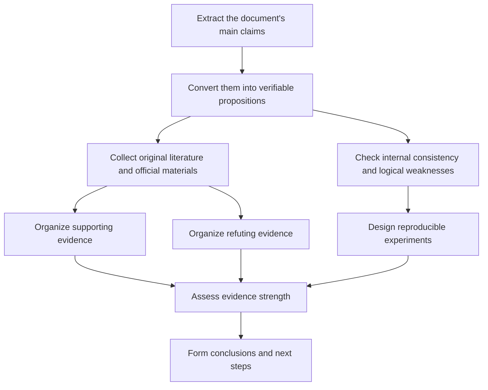

# Deep Reading, Validation, And Refutation Report On The Design Conception And Theory

## Executive Summary

`Design_Theory.md` is essentially not a paper centered on experimental results, but a design manifesto for a "next-generation agent runtime." The document argues that an agent should not only be understood as a model that can answer questions, but should be defined as a learnable system that can complete a closed loop of "hypothesis formation, action planning, external execution, evidence collection, result verification, commit or rollback, memory governance, failure localization, and recovery" under limited context, limited resources, and incomplete information. It concretizes this claim through canonical state, Execution IR, Evidence Packet, Context OS, Episode Journal, Failure Taxonomy, and a phased roadmap. The document provides no self-built experiments, sample sizes, effect sizes, ablation studies, or statistical tests. Therefore, at present it is more like a "research plan and architectural outline" than a theory that has already been empirically completed.

From the perspective of external literature, the problem direction captured by the document is broadly correct. Interleaving reasoning and action, tool use, long-term memory/context management, step-level verification, and agent safety are indeed the five core axes of agent research in the last two years. The related claims can be supported by ReAct, Toolformer, MemGPT, process supervision, long-context benchmarks, and multiple real-task benchmarks. In particular, in real interactive environments, current agent success rates remain far below human performance. For example, WebArena, OSWorld, tau-bench, AgentBench, and Agent-SafetyBench all show that existing systems still have clear gaps in action correctness, consistency, risk awareness, and safety.

But the document's largest problem is also clear: it elevates many reasonable research directions into an apparently complete "system theory" without giving enough operational definitions and validation designs. For example, the document introduces terms such as reasoning-to-action fidelity, evidence sufficiency, credit routing entropy, memory pollution, and commit integrity, but does not provide repeatable mathematical definitions or annotation schemes. This makes the most important conclusions directionally reasonable, but uneven in evidence strength. After synthesizing the literature, my judgment is: **H1 (reasoning-to-action translation is the core bottleneck) and H5 (governance and replay semantics are the safety foundation) have stronger support; H2 (Evidence Packet can significantly improve verifier reliability) and H3 (Context OS is more important than simply increasing the context window) have medium support; H4 (failure credit routing can significantly improve recovery efficiency) currently has the weakest direct evidence.**

Therefore, the most rigorous conclusion is not "this document has proposed a validated next-generation agent theory," but rather: **it proposes a highly worthwhile research agenda for implementation and testing, in which several modules and metrics have high research value, but the overall architecture has not yet been proven end-to-end to outperform simpler prompt-workflow, tool orchestration, or specialized agent designs.**

## Document Claims And Unspecified Items

After reading the full document, its main content can be summarized into five layers. First, it redefines agents: not as "models with stronger chat capability," but as "learnable closed-loop runtimes." Second, it extracts design principles from ReAct, Toolformer, Tree/Graph/LATS, Reflexion, Voyager, Generative Agents, MemGPT, LLMCompiler, and agent safety research, then absorbs those principles into a single architecture. Third, it proposes a three-layer architecture and five core primitives: Layer A cognition kernel, Layer B execution substrate, Layer C Context and governance; and canonical state, Execution IR, Evidence Packet, Working Set Compiler, and Episode Journal. Fourth, it proposes governance mechanisms such as Failure Taxonomy, Credit Routing, Targeted Recovery, memory write gate, pre/post verification, and commit/rollback/replay. Fifth, it proposes research hypotheses, evaluation metrics, and a five-stage roadmap centered on H1-H5.

In terms of "method, data, and conclusion," the document's method is **architectural synthesis after literature absorption**, not original experimentation. In terms of data, there is **no** self-built dataset, A/B control, failure case statistics, effect size, significance analysis, or benchmark score. The conclusions are normative, arguing that future agents should move toward "cognition-centered, execution-aware, evidence-grounded, context-governed, memory-disciplined, failure-attributable, replay-safe."

The following table lists the key items that I consider most important in the full document, but that are currently still "unspecified" or "insufficiently defined." These gaps directly affect whether the document can be validated, reproduced, and refuted.

| Item | Status | Description |
|---|---|---|
| Target application domain | Unspecified | Only candidate stress-test scenarios such as code repair and research assistant are listed; the first landing domain is not specified |
| Base model and training paradigm | Unspecified | It does not specify whether this is a single model, model family, distillation system, or whether additional fine-tuning/RL is needed |
| Canonical state representation form | Unspecified | It does not specify whether it is symbolic, graph, latent summary, hybrid memory object, or its serialization method |
| Verifier architecture | Unspecified | It does not define whether the verifier is same-model self-verification, independent model, rule engine, formal method, or a combination |
| Evidence Packet generation source | Unspecified | It does not define the generation mechanism for observation, provenance, failure logits, and credit hints |
| Primary metric formulas | Unspecified | reasoning_to_action_fidelity, evidence_sufficiency_score, credit_routing_entropy, and others have no mathematical definition |
| Safety escalation and human intervention threshold | Unspecified | high-risk action escalation and explicit escalation have no specified threshold or process |
| Memory write gate logic | Unspecified | It does not define how novelty, failure risk, freshness, and pollution are quantified |
| Cost/latency budget | Unspecified | It does not explain how token, latency, and storage overhead introduced by governance and verification are controlled |
| Success criteria and termination conditions | Unspecified | It does not define when to commit, rollback, merely abstain, or escalate |

## Research Method And Validation Framework

The validation method in this report is divided into four steps. First, split the document's design ideas into verifiable propositions, prioritizing the explicit H1-H5 in the document because they are the closest parts to research hypotheses. Second, prioritize searching original papers, official technical documents, benchmarks, and official governance frameworks, and organize English sources as Chinese summaries in the original report. Third, do not only look at supporting evidence for the document, but deliberately search for research that weakens, limits, or refutes the document's claims. Fourth, for each proposition, do three things at the same time: judge the strength of external evidence, check the internal consistency of the original text, and supplement the missing experimental design. The reason for doing this is that recent agent literature itself is quite fragmented. Multiple surveys point out that tool use, planning, feedback learning, test-time search, and memory governance still lack a unified semantic and evaluation framework. The document is trying to solve exactly this fragmentation problem, but the literature supports "integration is needed," not "the concrete solution it proposes has already been proven best."

The "evidence strength" in this report uses a three-level judgment. **Strong** means there are multiple direct, task-adjacent, and reproducible benchmarks or official documents that mutually support the point. **Medium** means there are one to two important studies or multiple indirect literatures supporting the point, but there remains an extrapolation distance from the document's proposition. **Weak** means the support mainly comes from theoretical inference or conceptual similarity, lacking direct ablation and quantitative evidence. In the original report, English sources are written as Chinese summaries, and original links can be opened directly from each citation.

## Item-By-Item Validation Results

### H1 Validation

The document's H1 is "reasoning-to-action fidelity is the core bottleneck of agent capability." If operationalized, the closest verifiable proposition is: **under the same backbone model, if language/reasoning quality is improved but action translation, tool interface, and state projection are not improved, end-to-end agent performance will still be constrained by the action-layer bottleneck.** This proposition has fairly strong external support overall. ReAct has already shown that pure text reasoning is worse than interleaving reasoning and action. WebArena shows that the best GPT-4 system has an end-to-end success rate of only 14.41%, far below human 78.24%. OSWorld shows that the best model reaches only 12.24%, while humans exceed 72.36%. tau-bench shows that even advanced function-calling agents have task success rates below 50%, and consistency across multiple runs is poor. AgentBench lists long-term reasoning, decision-making, and instruction following as major obstacles. Together, these results show that "being able to think" is not the same as "being able to act," and that there is indeed a large gap between language capability and interactive success.

However, this proposition also has important ambiguities in the document. First, the document does not formally define fidelity, so it cannot distinguish whether the problem lies in state representation, tool API, GUI grounding, observation normalization, or action schema. Second, external research also points out that **interface design itself** can greatly affect agent effectiveness. SWE-agent's main contribution is not a new reasoning theory, but an agent-computer interface, and that interface can significantly improve the behavior quality of programming agents. This means H1 is very likely correct, but it does not necessarily mean that the "internal cognitive runtime" is more important than "tool/interface design." At least in some scenarios, the bottleneck may first lie in affordance, not cognition. This is the first important refutation of the document.

To truly validate H1, I recommend using three controlled groups with the same backbone: Group A as a ReAct/traditional function-calling baseline; Group B adding Execution IR and observation normalization; Group C further adding pre/post verifier and episode journal. The independent variable is runtime structure, and dependent variables are task success, invalid action rate, state-transition consistency, tool-argument correctness, and human-reviewed rationale-to-action alignment. Benchmarks can include WebArena, OSWorld, and tau-bench with roughly 400 episodes per group each. If the goal is to detect a success-rate difference of about 10 percentage points, a two-proportion comparison requires about 388 episodes per group. If the goal is to reduce invalid action or false accept from 15% to 10%, about 686 high-risk episodes per group are needed. Analysis should use mixed-effects logistic regression, with benchmark and task type as random effects.

### H2 Validation

The document's H2 is "Evidence Packet can significantly improve verifier reliability." If converted into a verifiable proposition, it should be: **changing the verifier from looking only at the final answer to consuming structured pre-state, action, observation, post-state, constraint violations, and provenance can reduce false accept and improve calibration.** There is currently no paper that directly supports the exact schema in the document, but the "direction" has medium support. Process supervision research shows that supervising intermediate steps is clearly better than looking only at final outcomes. "Let's Verify Step by Step" even points out that process supervision significantly outperforms outcome supervision on MATH. On the other hand, Chain-of-Verification shows that moving verification questions earlier and letting the model independently verify its own draft can reduce hallucination. These literatures are consistent with the document's core intuition: **if intermediate evidence is explicitly structured, verification is usually more reliable than only doing end-state judging.**

But H2's weakness is also very important. First, external literature supports "step-level supervision" and "verification processes," not the necessary effectiveness of the Evidence Packet schema defined by the document. Second, recent work on faithfulness points out that chain-of-thought and verbal explanations are often not the model's real decision reasons. "Language Models Don't Always Say What They Think" and "Measuring Faithfulness in Chain-of-Thought Reasoning" both remind us that if packet content mainly comes from model self-report rather than external observation and verifiable provenance, it may only package unfaithful reasons more neatly. Third, 2026 General AgentBench tests point out that one core limitation of parallel scaling is the verification gap. This conversely shows that the verifier problem is very important, but also means the document cannot directly assume that "one structured packet can solve verifier."

Therefore, my judgment on H2 is: **directionally correct and structurally reasonable, but the evidence strength for the exact schema is only medium.** For validation design, a high-risk action benchmark should be built so the verifier can be compared under three conditions: seeing only final answer, seeing full trace, and seeing structured Evidence Packet. Primary metrics should include false accept, false reject, AUROC, Brier score, ECE, required_extra_evidence hit rate, and abstention quality for high-risk actions. To detect false accept dropping from 15% to 10%, about 686 high-risk episodes are needed per group. More importantly, the packet's observation and provenance should come as much as possible from external tool logs, environment state diffs, document sources, and version information, rather than freely generated model narratives.

### H3 Validation

The document's H3 is "Context OS is more important than simply increasing the context window." This is one of the most insightful claims in the document, but also one of the easiest to overstate. The support side is clear: MemGPT directly treats limited context as a working set problem in an operating system. Lost in the Middle points out that long-context models are significantly fragile in their use of middle-position information. RULER further shows that many models claiming support for 32K+ context drop sharply on more complex tasks and longer sequences. All these studies support the document's core judgment: **"context is not better when more is stuffed in"; how to select, compress, preserve provenance, and avoid branch contamination is indeed one of the cores of long-task stability.**

But the refutation is equally important. LongBench is a bilingual Chinese-English multi-task long-text benchmark. On one hand, it confirms that retrieval/compression can help weaker long-context models. On the other hand, it clearly points out that **although retrieval or context compression helps, performance still often lags behind models with stronger native long-context capability.** This means that if H3 is stated as "Context OS is always more important than a larger context window," it is too strong. A more rigorous statement should be: **when cost is constrained, tasks have multi-stage control state, and provenance and replay are needed, working set quality is often more critical than nominal context length; but in some tasks requiring global visibility, cross-segment reasoning, or global consistency, native long-context capability remains an irreplaceable foundation.**

The document's internal weakness is that it proposes many working set compilation decisions but does not define any implementation strategy or optimization target. For example, the decision logic for pin/summarize/store pointer/retain evidence, freshness decay, branch isolation, and quantification of provenance loss are all still blank. To validate H3, I recommend establishing three conditions on LongBench, GAIA-like long tasks, and multi-document tasks: native long context, pure retrieval/RAG, and a working set compiler with provenance retention. In addition to task accuracy, metrics should include token cost, latency, information-position sensitivity, provenance loss, and middle-position robustness. H3 is truly established only if the compiler significantly outperforms raw stuffing under a fixed token budget. If it holds only on small models but not on strong long-context models, H3 should be revised into a conditional proposition.

### H4 Validation

The document's H4 is "failure credit routing can improve recovery efficiency." I consider this the claim with the most research value in the document, but also the weakest direct empirical evidence. The best supporting literature is Reflexion and Self-Refine: both types of methods show that after errors, directional revision based on feedback often works better than one-shot output. The document further structures this idea into Failure Taxonomy, credit vector, and Targeted Recovery, which is a conceptually reasonable extension.

But what is missing is exactly "direct ablation." On one hand, Reflexion and Self-Refine prove that "trying again with feedback is sometimes effective," not that "formal Credit Routing is necessarily better than blind retry." On the other hand, 2026 General AgentBench indicates that simply increasing sequential/parallel test-time scaling runs into context ceilings and verification gaps. This shows that blind retry is not a cure-all, but also reminds us: if the gains from targeted recovery actually come from extra test-time compute rather than more accurate failure attribution, then the document overestimates the necessity of taxonomic Credit Routing. Furthermore, the document itself acknowledges that reflection memory without a write gate will pollute long-term memory. Therefore, what H4 needs most is not more concepts, but rigorous failure-class ablation.

I recommend testing H4 in a controlled fault-injection environment. First manually inject four types of failures in a toy environment: representation error, procedure error, context omission, and verification miss. Compare three groups with the same backbone: blind retry, increased search depth, and targeted recovery. Dependent variables should include at least recovery success, step cost, token cost, repeated failure rate, memory pollution rate, and whether the recovery repaired the correct failure layer. If recovery gain rises from 20% to 30%, a rough two-proportion estimate requires about 293 episodes per group. If subdividing by failure class, at least 300 episodes per class per group are recommended. Only when targeted recovery remains significantly better than blind retry **under similar total compute** should H4 be considered truly established.

### H5 Validation

The document's H5 is "Episode governance is the core foundation of agent safety." Among all hypotheses, this one is closest to cross-domain consensus. From agent benchmarks, Agent-SafetyBench shows that none of 16 popular agents has a safety score above 60%, with main defects being insufficient robustness and risk awareness. AgentDojo shows that when agents process untrusted external data, defending against prompt injection remains very difficult. InjecAgent shows that ReAct-prompted GPT-4 can have around a 24% attack success rate under indirect prompt injection. These studies do not only tell us "the model answers incorrectly"; they tell us that "agents make dangerous actions in real tools and external content." From this perspective, the document's insistence on precheck, postcheck, commit discipline, rollback, replay, and provenance is directionally very solid.

From official governance and software engineering literature, this claim also receives external support. NIST's AI RMF explicitly lists the core attributes of trustworthy AI as valid and reliable, safe, secure and resilient, accountable and transparent, explainable, privacy-enhanced, and fair, and requires the four risk management functions GOVERN, MAP, MEASURE, and MANAGE throughout the lifecycle. Saga guidance points out that when multi-step flows fail, governance is needed between forward recovery and backward recovery (compensating transactions). Official workflow documents further emphasize event history, replay, determinism, atomicity, and idempotency. These are not agent papers themselves, but they provide the most important external analogy for the document: **when a system starts producing side effects on the external world, reliability is no longer only a reasoning problem, but an execution governance problem.**

However, H5 still needs one key correction: the document sometimes describes rollback too much like a database transaction, but many actions in the external world are actually **irreversible**. In this case, strict rollback does not exist; only compensation, reconciliation, or human escalation is possible. In other words, the document's governance layer should explicitly distinguish reversible, compensable, and irreversible actions, instead of treating them all as the same type of "committable/rollbackable" semantics. If this point is not corrected, the document will over-idealize distributed workflow semantics in the part that most requires rigor.

To validate H5, the most suitable experimental environment is not static QA, but a sandbox with real side-effect classes. READ_ONLY, REVERSIBLE, COMMITTABLE, IRREVERSIBLE, and MEMORY_WRITE tool actions can be designed so an ungoverned baseline and governed runtime are compared on the same tasks for unsafe_action_rate, rollback_success_rate, replay_consistency, audit completeness, and operator intervention burden. If the governed system can significantly reduce unsafe commits and postmortem ambiguity in high-risk episodes, H5 would receive very strong empirical support.

## Refutations And Alternative Theories

### Interface And Tool Design May Be More Important Than The Internal Closed Loop

A strong refutation is: the document mainly locates the problem in "runtime semantics and governance," but in the real world, the main bottleneck may first come from agent-computer interface, tool design, and environmental affordance, rather than canonical state or Credit Routing. SWE-agent's results especially support this point: the interface specifically designed for agents itself can significantly improve performance. This indicates that engineering quality of the external action space may be as important as internal reasoning structure, or even more important. **Evidence strength: strong.** Additional evidence needed: strict controlled experiments that change only runtime structure under exactly the same tool interface.

### Native Long-Context Capability And Context OS Should Be Parallel, Not Subordinate

The document places Context OS in a more foundational position than a large context window, but LongBench has already provided an important qualification: retrieval and compression help weak long-context models, but may not surpass models that truly have strong long-context capability. Therefore, a more reasonable alternative theory is: **native long-context capability and working set compilation are complementary, not one-way substitutes.** **Evidence strength: medium.** Additional evidence needed: a four-quadrant experiment with the same model at different context lengths, with and without a compiler.

### High-Risk Scenarios May Require External Formal Methods Rather Than Only Learned Control

The document emphasizes the centrality of learned control, which has its elegance. But in high-risk scenarios, another alternative theory is more conservative: externalize risk gating, policy enforcement, idempotency, compensation, and human approval as much as possible, avoiding one language model simultaneously serving as planner, actor, judge, and memory writer. Prompt injection and agent safety benchmarks show that language-layer defenses alone are usually insufficient. Official workflow and risk frameworks also tend toward external governance. **Evidence strength: medium-strong.** Additional evidence needed: compare the safety/performance trade-off between "learned policy only" and "learned policy + external policy engine" on the same task.

### The Gains From Targeted Recovery May Not Come From Credit Routing Itself

The document views blind retry very negatively, but another possibility is that many recovery gains actually come from extra test-time compute, more observation samples, or better verifier behavior, rather than from Failure Taxonomy itself. General AgentBench has pointed out that sequential scaling and parallel scaling are respectively limited by context ceiling and verification gap. This suggests that the real key may be **how to manage extra computation and verification cost**, not necessarily the semantic design of a failure credit vector. **Evidence strength: medium.** Additional evidence needed: compute-matched ablation, comparing blind retry and targeted recovery under the same token and time budget.

### The Document As A Whole Is More Like A Research Agenda Than A Proven Unified Theory

From surveys and general agent evaluation frameworks, the field is still in a stage of fragmented methods, heterogeneous benchmarks, and insufficient cross-environment generality. This means the document's greatest value is likely not "proving that it is correct," but "proposing a research agenda that can be programmatically tested." **Evidence strength: strong.** Additional evidence needed: complete implementation and public ablation in a single vertical scenario.

## Comparison Table And Validation Design

The following table integrates the literature cited in previous sections and the document's content, listing the document's main claims, supporting evidence, refutation points, recommended validation methods, and evidence strength. Detailed sources and Chinese summaries have already been explained item by item in previous sections of the original report.

| Main Claim In Original Text | Supporting Evidence | Refutation Point | Recommended Validation Method | Evidence Strength |
|---|---|---|---|---|
| H1 reasoning-to-action translation is the core bottleneck | ReAct; WebArena; OSWorld; tau-bench; AgentBench | Failure may mainly come from tool interface and environmental affordance, not internal runtime | Under the same backbone, compare baseline, Execution IR, and Execution IR+verifier on end-to-end performance and invalid action | Strong |
| H2 Evidence Packet can improve verifier reliability | Process supervision; Chain-of-Verification | The packet schema itself has not been directly proven; if packet content comes from unfaithful self-report, it may mislead the verifier | final-answer judge vs trace judge vs packet judge; measure FAR/FRR/ECE/AUROC | Medium |
| H3 Context OS is more important than simply enlarging context | MemGPT; Lost in the Middle; RULER | LongBench shows retrieval/compression helps, but often still lags behind native strong long-context models | raw long context vs retrieval vs working-set compiler; compare under fixed token budget | Medium |
| H4 Failure credit routing can improve recovery efficiency | Reflexion; Self-Refine | Direct evidence is insufficient; gains may only come from doing more reasoning or more compute | In a fault-injection environment, compare blind retry, deeper search, and targeted recovery | Weak to medium |
| H5 Episode governance is the foundation of agent safety | Agent-SafetyBench; AgentDojo; InjecAgent; NIST AI RMF; workflow/saga docs | Rollback is not always possible; governance also cannot replace understanding, grounding, and safety adversarial testing | In a high-risk tool sandbox, compare unsafe commits, replay, audit, and compensation quality with and without governance layer | Medium to strong |
| Overall closed-loop runtime is better than tool-first / workflow-first patchwork | Multiple surveys support the need for field integration | There is still no direct end-to-end evidence showing this architecture outperforms simpler specialized systems | Stage 1-4 progressive ablation, publishing cost, latency, success rate, and safety metrics | Medium |

To actually land the validation plans in the table, I recommend using conservative rough estimates from two-proportion comparison: detecting a 10 percentage point difference commonly requires about **250-390 episodes per group**; if the goal is to reduce false accept from **15% to 10%**, high-risk episodes require about **686 per group**. In agent research, these episodes should ideally be stratified by task difficulty, side-effect class, tool type, and failure class. Otherwise, architecture effects are easily overestimated due to dataset composition differences.

## Conclusion And Actionable Next Steps

In summary, the most commendable aspect of this document is not that it has already proven a final architecture, but that it points out more clearly than most agent design notes several genuinely difficult problems that are often hidden by workflow engineering: **the boundary between state and execution, step-level verification, context governance, memory pollution, failure attribution, and governance semantics for external side effects.** These are not pseudo-problems. External benchmarks have repeatedly shown that when agents leave pure text evaluation and enter tool and environment interaction, simple prompt chaining quickly hits ceilings in performance, consistency, and safety.

But it is equally clear that: **the document has not yet completed the final step required for "theory establishment," namely reproducible, comparable, statistically testable empirical evidence.** Therefore, the most reasonable positioning is to treat it as a high-quality research specification draft worth formalizing, not as a unified theory already validated by the literature. If you want to push it into a real research program, it is best not to build the full system directly, but to begin with controlled scenarios, clear metrics, and compute-matched ablation.

The next steps you can execute directly are as follows.

1. **First freeze terminology and metric definitions.** Rewrite terms such as canonical state, Evidence Packet, verifier_false_accept_rate, context_provenance_loss, memory_pollution_rate, and commit_integrity_score into computable fields and formulas. If this cannot be done, all subsequent experiments will lose focus.

2. **Select only one first vertical domain.** I recommend prioritizing "document operations agent" or "research assistant agent," because they have more reversible operations, clearer data sources, and lower side-effect risk than real e-commerce or computer control, making them more suitable for first validating verifier, provenance, working set, and memory gate. The document itself also lists vertical stress testing as a necessary step in Stage 5.

3. **Build Stage 1-2 first; do not directly build full governance.** The first version should only implement `state -> plan -> action -> evidence -> verify -> commit/abort`, then add failure classification and Targeted Recovery. Do not start by building full memory hierarchy and high-cost governance. This also follows the document's own phase-based activation principle.

4. **Establish the minimal reproducible benchmark mix.** The internal benchmark should have at least three groups: one long-text/multi-document task group, one tool-interaction task group, and one high-risk/safety task group. Public references can align with the design ideas of LongBench, WebArena, OSWorld, tau-bench, AgentDojo, Agent-SafetyBench, and others.

5. **Collect the data you truly lack, rather than writing more architecture documents first.** The most important data has four types: step-level verifier labels, state-transition logs, tool provenance/version logs, and memory write outcomes. If step-level human labels can be obtained, the PRM800K-style data approach can be directly borrowed.

6. **Put safety and governance design into an external sandbox, not only into prompts.** Classify READ_ONLY, REVERSIBLE, COMMITTABLE, and IRREVERSIBLE actions. High-risk operations must have human approval or a policy engine. This is not conservatism, but a necessary condition jointly supported by safety benchmarks and official risk governance documents.

7. **Prioritize finding four types of collaborators.** The first type is distributed workflow/reliability engineers, responsible for replay, idempotency, and compensation. The second type is agent evaluation researchers, responsible for benchmark and statistical design. The third type is safety/red-team personnel, responsible for prompt injection and unsafe action testing. The fourth type is domain experts in the chosen vertical scenario, responsible for defining the side effects and success conditions that truly matter.

8. **Publish an ablation-first research plan.** At minimum, it must include: baseline, newly added module at each stage, fixed compute budget, fixed tool set, primary metrics, predefined Failure Taxonomy labeling criteria, and stopping conditions. Only then will this document move from an "insightful manifesto" into "theory engineering that can be validated and refuted."
