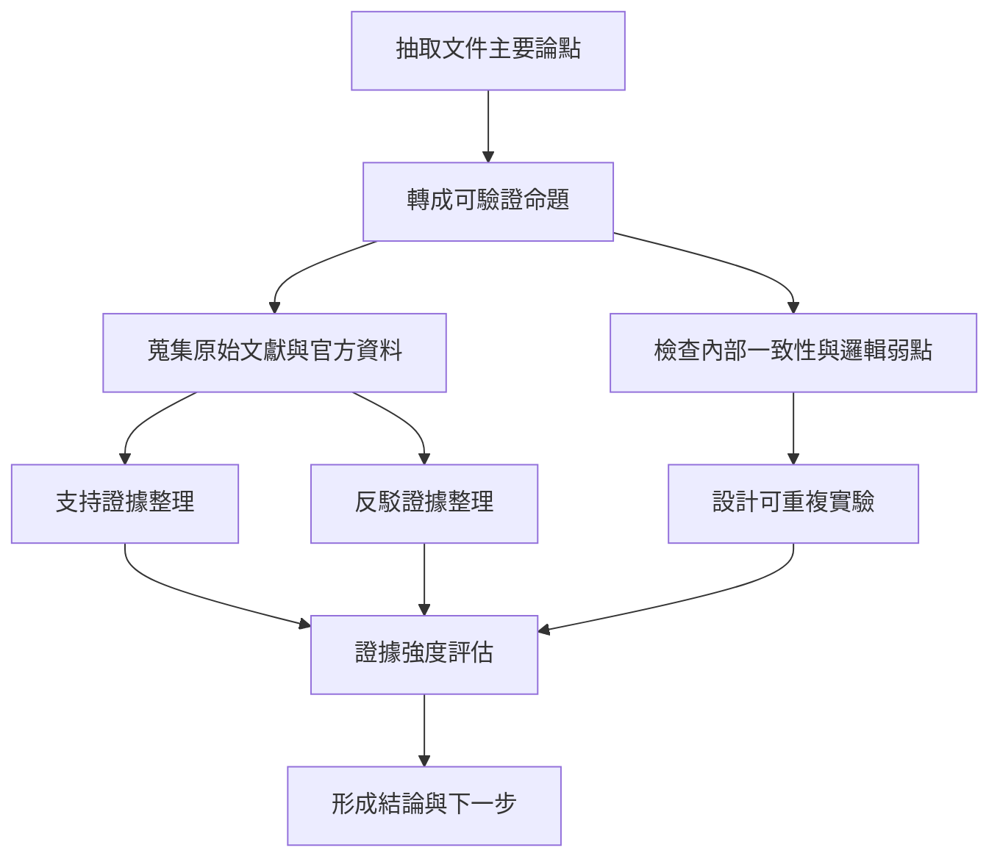

# 設計構想與理論深度研讀、驗證與反駁報告

## Executive Summary

《設計構想與理論.md》本質上不是一份以實驗結果為主的論文，而是一份面向「下一代智能體 runtime」的設計宣言。文件主張，智能體不應只被理解為會回答問題的模型，而應被定義為一個能在有限 context、有限資源與不完全資訊下，完成「假設形成、行動規劃、外部執行、證據蒐集、結果驗證、提交或回退、記憶治理、失敗定位與恢復」閉環的可學習系統；並以 canonical state、Execution IR、Evidence Packet、Context OS、Episode Journal、Failure Taxonomy 與分階段路線圖來具體化該主張。文件沒有提供任何自建實驗、樣本數、效應量、消融研究或統計檢定，因此它目前更像「研究計畫與架構綱領」，而不是已被實證完成的理論。

從外部文獻看，文件所抓住的問題方向大致正確。推理與行動交錯、工具使用、長期記憶/上下文管理、步驟級驗證、以及 agent safety，確實是近兩年 agent 研究最核心的五個主軸；相關主張可從 ReAct、Toolformer、MemGPT、過程監督、長上下文基準與多個真實任務 benchmark 得到支持。尤其是在真實互動環境裡，當前 agent 的成功率仍遠低於人類，例如 WebArena、OSWorld、τ-bench、AgentBench 與 Agent-SafetyBench 都顯示，現有系統在行動正確性、一致性、風險意識與安全性上仍存在明顯缺口。

但文件最大的問題也很清楚：它把許多合理的研究方向，提升為一套看似完整的「系統理論」，卻沒有給出足夠的操作化定義與驗證設計。例如，什麼叫 reasoning-to-action fidelity、evidence sufficiency、credit routing entropy、memory pollution、commit integrity，文件都提出了名詞，卻沒有提供可重複量測的數學定義或標註方案。這使得最重要的結論雖然方向上合理，證據強度卻不均勻。綜合文獻後，我的判定是：**H1（推理到行動轉譯是核心瓶頸）與 H5（治理與可回放語義是安全基礎）支撐較強；H2（Evidence Packet 可顯著提升 verifier 可靠性）與 H3（Context OS 比單純增加 context window 更重要）支撐中等；H4（failure credit routing 可顯著改善 recovery efficiency）目前直接證據最弱。**

因此，最嚴謹的結論不是「這份文件已提出被驗證的下一代 agent 理論」，而是：**它提出了一套高度值得實作與測試的研究綱領，其中若干模組與指標具有很高研究價值，但整體架構目前尚未被端到端證明優於較簡單的 prompt-workflow、工具編排或專門化 agent 設計。**

## 文件主張與未指定項目

通讀全文後，文件的主要內容可以概括為五層。第一，它重新定義智能體：不是「聊天能力更強的模型」，而是「可學習的閉環 runtime」。第二，它從 ReAct、Toolformer、Tree/Graph/LATS、Reflexion、Voyager、Generative Agents、MemGPT、LLMCompiler 與 agent safety 研究，抽取設計原則，並將這些原則吸收到單一架構中。第三，它提出三層架構與五種核心原語：Layer A 認知核、Layer B 執行基底、Layer C Context 與治理；以及 canonical state、Execution IR、Evidence Packet、Working Set Compiler、Episode Journal。第四，它提出 failure taxonomy、credit routing、targeted recovery、memory write gate、pre/post verification、commit/rollback/replay 等治理機制。第五，它提出以 H1–H5 為中心的研究假設、評估指標與五階段路線圖。

就「方法、數據、結論」而言，文件的方法是**文獻吸收後的架構綜合**，不是原始實驗；數據方面，**沒有**自建資料集、A/B 對照、失敗案例統計、效應量、顯著性分析或 benchmark 成績；結論則是規範性的，主張未來 agent 應該朝「cognition-centered、execution-aware、evidence-grounded、context-governed、memory-disciplined、failure-attributable、replay-safe」前進。

下表列出我認為全文最重要、但目前仍屬「未指定」或「定義不充分」的關鍵項目；這些空缺會直接影響文件能否被驗證、複現與反駁。

| 項目 | 狀態 | 說明 |
|---|---|---|
| 目標應用場域 | 未指定 | 僅列出 code repair、research assistant 等候選壓測場景，未指定首要落地領域 |
| 基礎模型與訓練範式 | 未指定 | 未指定是單模型、模型家族、蒸餾體系，或是否需額外微調/RL |
| Canonical state 表示形式 | 未指定 | 未說明是 symbolic、graph、latent summary、hybrid memory object，或其序列化方式 |
| Verifier 架構 | 未指定 | 未定義 verifier 是同模型自驗證、獨立模型、規則引擎、形式方法，或其組合 |
| Evidence Packet 生成來源 | 未指定 | 未定義 observation、provenance、failure logits 與 credit hints 的產生機制 |
| 主要指標公式 | 未指定 | reasoning_to_action_fidelity、evidence_sufficiency_score、credit_routing_entropy 等均無數學定義 |
| 安全升級與人工介入門檻 | 未指定 | high-risk action escalation、explicit escalation 未指定閾值與流程 |
| 記憶 write gate 邏輯 | 未指定 | 未定義 novelty、failure risk、freshness、pollution 的量化方式 |
| 成本/延遲預算 | 未指定 | 未說明治理與驗證帶來的 token、latency、storage overhead 如何控制 |
| 成功標準與終止條件 | 未指定 | 未定義何時 commit、何時 rollback、何時 merely abstain 或 escalate |

## 研究方法與驗證框架

本報告的驗證方法分成四步。第一步，將文件中的設計理念拆成可驗證命題，優先以文件明示的 H1–H5 為主，因為那是全文最接近研究假設的部分。第二步，優先搜尋原始論文、官方技術文件、基準測試與官方治理框架，並以中文摘要方式整理英文來源。第三步，不只看支持文件的證據，也刻意搜尋會削弱、限定或反駁文件主張的研究。第四步，對每一命題同時做三件事：判斷外部證據強度、檢查原文的內部一致性、補足原文缺乏的實驗設計。這樣做的理由在於，近年的 agent 文獻本身就相當碎片化；多篇綜述指出，工具使用、規劃、反饋學習、test-time search 與記憶治理之間，仍缺乏統一的語義與評估框架。文件想解決的正是這個碎片化問題，但文獻支持的是「需要統整」，而不是「它提出的具體方案已被證明最佳」。

本文中的「證據強度」採三段式判定。**強**表示有多個直接、任務相近且可重複的 benchmark 或官方文件相互支持；**中**表示有一到兩篇重要研究或多篇間接文獻支持，但與文件命題之間仍有外推距離；**弱**表示主要是理論推定或概念相似，缺少直接消融與量化證據。英文來源一律以中文摘要撰寫，原始連結可直接由各引文開啟。

## 逐項驗證結果

### H1 驗證

文件的 H1 是「reasoning-to-action fidelity 是 agent 能力的核心瓶頸」。如果把它操作化，最接近的可驗證命題是：**在同一 backbone model 下，若只提升語言/推理品質，但不改善行動轉譯、工具介面與狀態投影，端到端 agent 表現仍會被行動層瓶頸限制。** 這個命題整體上有相當強的外部支持。ReAct 已經證明單純文本推理不如推理與行動交錯；WebArena 顯示最佳 GPT-4 系統端到端成功率僅 14.41%，遠低於人類 78.24%；OSWorld 顯示最佳模型僅 12.24%，人類則超過 72.36%；τ-bench 顯示即使是先進 function-calling agent，任務成功率也低於 50%，且多次試跑的一致性很差；AgentBench 則把長期推理、決策與指令遵循列為主要障礙。這些結果共同說明：「會想」不等於「會做」，語言能力與互動成功之間確實存在巨大落差。

不過，這一命題在文件中的表述也有重要模糊點。第一，文件沒有正式定義 fidelity，無法區分問題到底出在 state 表徵、工具 API、GUI grounding、觀察正規化，還是 action schema。第二，外部研究同時指出，**介面設計本身**就能大幅影響 agent 成效；SWE-agent 的主要貢獻不是新推理理論，而是 agent-computer interface，且該介面能顯著提升程式代理的行為品質。這意味著 H1 很可能是對的，但它未必代表「內部認知 runtime」比「工具/介面設計」更關鍵；至少在某些場景，瓶頸可能先在 affordance，而不是 cognition。這是對文件的第一個重要反駁。

若要真正驗證 H1，我建議採用同 backbone 的三組對照：A 組為 ReAct/傳統 function-calling baseline；B 組加入 Execution IR 與 observation normalization；C 組再加入 pre/post verifier 與 episode journal。自變數是 runtime 結構，依變數是 task success、invalid action rate、state-transition consistency、tool-arg correctness 與人工審核的 rationale-to-action alignment。基準可選 WebArena、OSWorld 與 τ-bench 各約 400 個 episode/組；若目標是偵測約 10 個百分點的成功率差異，兩比例比較下每組約需 388 個 episode；若目標是把 invalid action 或 false accept 由 15% 降到 10%，則高風險 episode 約需 686 個/組。分析建議採混合效應 logistic regression，以 benchmark 與任務類型作為隨機效果。

### H2 驗證

文件的 H2 是「Evidence Packet 能顯著提升 verifier reliability」。若將其化為可驗證命題，應是：**把 verifier 從只看最終答案，改成消費結構化的前置狀態、行動、觀察、後置狀態、限制違反與 provenance，能降低 false accept 並改善校準。** 直接支持文件 exact schema 的論文目前沒有，但「方向」有中度支持。過程監督研究顯示，對中間步驟給監督，明顯優於只看最終結果；《Let’s Verify Step by Step》甚至指出 process supervision 在 MATH 上顯著優於 outcome supervision。另一方面，Chain-of-Verification 顯示，把驗證問題前移，並讓模型對自己的草稿執行獨立驗證，可降低 hallucination。這些文獻與文件的核心直覺一致：**中間證據若被明確結構化，驗證通常比只做 end-state judging 更可靠。**

但 H2 的弱點也非常關鍵。第一，外部文獻支持的是「步驟級監督」與「驗證流程」，不是文件所定義的 Evidence Packet schema 必然有效。第二，近年的 work on faithfulness 指出，chain-of-thought 與口頭解釋常常不是模型真實決策原因；《Language Models Don’t Always Say What They Think》與《Measuring Faithfulness in Chain-of-Thought Reasoning》都提醒我們，若 packet 內容主要來自模型自述，而不是外部 observation 與可核 provenance，它可能只會把不忠實的理由包裝得更整齊。第三，2026 的 General AgentBench 測試指出，parallel scaling 的核心限制之一就是 verification gap；這反而說明 verifier 問題非常重要，但也表示文件不能直接假設「一個結構化 packet 就能解決 verifier」。

因此，我對 H2 的判斷是：**方向正確、結構合理，但對 exact schema 的證據強度只有中等。** 驗證設計上，應建立一個高風險 action benchmark，讓 verifier 在三種條件下比較：只看 final answer、看完整 trace、看結構化 Evidence Packet。主要指標應包括 false accept、false reject、AUROC、Brier score、ECE、required_extra_evidence 命中率，以及高風險 action 的 abstention quality。若要檢測 false accept 由 15% 降至 10%，每組約需 686 個高風險 episode。更重要的是，packet 的 observation 與 provenance 應盡可能取自外部工具日志、環境 state diff、文件來源與版本資訊，而不是模型自由生成的敘述。

### H3 驗證

文件的 H3 是「Context OS 比單純增加 context window 更重要」。這是全文最有洞見、但也最容易被過度陳述的一條。支持面很明確：MemGPT 直接把有限 context 視為作業系統中的工作集問題；Lost in the Middle 指出，長上下文模型對中段資訊的利用顯著脆弱；RULER 更進一步顯示，很多宣稱支援 32K 以上 context 的模型，在更複雜任務與更長序列下表現大幅下降。這些研究都支持文件的核心判斷：**「context 不是塞越多越好」，如何選、壓、保留 provenance 與避免 branch contamination，確實是長任務穩定性的核心之一。**

但反駁也同樣重要。LongBench 是一個中英雙語、多任務長文本 benchmark，它一方面證實檢索/壓縮能幫助弱長上下文模型，另一方面也明白指出：**retrieval 或 context compression 雖有幫助，但表現仍落後於原生長上下文能力更強的模型。** 這意味著 H3 若表述成「Context OS 一定比更大 context window 更重要」，就太強了。較嚴謹的表述應該是：**在成本受限、任務有多階段控制狀態、需要 provenance 與回放時，working set quality 往往比名義 context length 更關鍵；但在某些需要整體可見性、跨段推理或全局一致性的任務裡，原生長上下文能力仍是不可替代的基礎能力。**

文件的內部弱點在於，它提出了非常多 working set 編譯決策，但沒有定義任何實作策略或最佳化目標。例如 pin/summarize/store pointer/retain evidence 的決策邏輯、freshness decay、branch isolation、provenance loss 的量化，全部仍是空白。要驗證 H3，建議在 LongBench、GAIA 類長任務與多文件任務上建立三組條件：原生長 context、純 retrieval/RAG、具 provenance retention 的 working set compiler。指標除了任務正確率，還應納入 token cost、latency、資訊位置敏感度、provenance loss 與 middle-position robustness。若在固定 token budget 下 compiler 顯著優於 raw stuffing，H3 才真正成立；若只是在小模型上成立而在強長上下文模型上不成立，則 H3 應被修正為條件式命題。

### H4 驗證

文件的 H4 是「failure credit routing 能改善 recovery efficiency」。這是我認為全文最有研究價值、但直接實證最弱的一條。支持它的最佳文獻是 Reflexion 與 Self-Refine：這兩類方法都說明，錯誤之後若能根據反饋做有方向的修正，往往比一次性輸出更好；文件將這個想法更進一步結構化為 failure taxonomy、credit vector 與 targeted recovery，概念上是合理延伸。

但目前缺的正是「direct ablation」。一方面，Reflexion 與 Self-Refine 證明的是「帶反饋的再次嘗試有時有效」，不是「形式化 credit routing 一定優於 blind retry」。另一方面，2026 的 General AgentBench 表明，單純增加 sequential/parallel test-time scaling 會撞到 context ceiling 與 verification gap；這說明 blind retry 不是萬靈丹，卻也同時提醒：若 targeted recovery 的收益其實只是來自額外 test-time compute，而不是來自更準確的 failure attribution，文件便高估了 taxonomic credit routing 的必要性。再者，文件自己也承認 reflection memory 若沒有 write gate 會污染長期記憶；因此 H4 最需要的不是更多概念，而是嚴格的 failure-class ablation。

我建議把 H4 放入可控故障注入環境測試。先在 toy environment 中手工注入四種失敗：representation error、procedure error、context omission、verification miss。對同一 backbone 比較三組：blind retry、增加 search depth、targeted recovery。依變數至少應包括 recovery success、步數成本、token 成本、再次失敗率、memory pollution rate 與是否修對 failure layer。若從 20% 的 recovery gain 提升到 30%，兩比例粗估每組約需 293 個 episode；若要更細分到 failure class，建議每一類至少 300 個 episode/組。只有當 targeted recovery 在**控制總 compute 相近**的前提下仍顯著優於 blind retry，H4 才應被視為真正成立。

### H5 驗證

文件的 H5 是「Episode governance 是 agent 安全性的核心基礎」。在所有假設中，這一條最接近跨域共識。從 agent 基準看，Agent-SafetyBench 顯示 16 個熱門 agent 沒有任何一個安全分數超過 60%，主要缺陷是 robustness 與 risk awareness 不足；AgentDojo 顯示 agent 在處理不可信外部資料時，prompt injection 攻擊防禦仍非常困難；InjecAgent 則顯示 ReAct-prompted GPT-4 在間接 prompt injection 下可有約 24% 的攻擊成功率。這些研究不只告訴我們「模型會答錯」，更告訴我們「agent 會在真實工具與外部內容中做出危險行動」。從這個角度看，文件 insist on precheck、postcheck、commit discipline、rollback、replay 與 provenance，方向上非常扎實。

從官方治理與軟體工程文獻看，這個主張也得到外部支撐。NIST 的 AI RMF 把 trustworthy AI 的核心屬性明確列為 valid and reliable、safe、secure and resilient、accountable and transparent、explainable、privacy-enhanced 與 fair，並要求 GOVERN、MAP、MEASURE、MANAGE 四類風險管理功能貫穿生命週期。 的 saga guidance 則指出，當多步驟流程失敗時，需要在 forward recovery 與 backward recovery（補償交易）之間做治理； 的官方工作流文件進一步強調 event history、replay、determinism、atomicity 與 idempotency。這些都不是 agent 論文本身，但它們提供了文件最重要的外部類比：**當系統開始對外部世界產生副作用時，可靠性不再只是推理問題，而是執行治理問題。**

不過，H5 仍需一個關鍵修正：文件有時把 rollback 說得過於像資料庫交易，但對外部世界的很多動作其實是**不可逆**的。在這種情況下，嚴格 rollback 不存在，只能做 compensation、reconciliation 或人工升級。也就是說，文件的治理層理應明確區分 reversible、compensable 與 irreversible action，而不是把它們統稱為「可提交/可回退」的同一類語義。若不修正這一點，文件會在最需要嚴謹的部分，把分散式工作流語義過度理想化。

若要驗證 H5，最適合的實驗環境不是靜態 QA，而是帶有真實 side effect class 的 sandbox。可設計 READ_ONLY、REVERSIBLE、COMMITTABLE、IRREVERSIBLE、MEMORY_WRITE 五類工具動作，讓無治理 baseline 與有治理 runtime 在相同任務上比較 unsafe_action_rate、rollback_success_rate、replay_consistency、audit completeness 與 operator intervention burden。若在高風險 episode 中，有治理系統能顯著降低 unsafe commits 與 postmortem ambiguity，H5 就會得到非常強的實證支持。

## 反駁與替代理論

### 介面與工具設計可能比內部閉環更重要

一個強力反駁是：文件把問題主要定位在「runtime 語義與治理」，但真實世界中的主要瓶頸，可能首先來自 agent-computer interface、工具設計與環境可供性，而不是 canonical state 或 credit routing。SWE-agent 的結果尤其支持這一點：專門為代理設計的介面本身就能顯著提高表現，這表示外部行動空間的工程品質可能與內部 reasoning 結構同等重要，甚至更重要。**證據強度：強。** 還需要的額外證據是：在完全相同工具介面下，只改 runtime 結構的嚴格對照實驗。

### 原生長上下文能力與 Context OS 應並列，而不是從屬

文件把 Context OS 擺在比大 context window 更基礎的位置，但 LongBench 其實已經提供了重要限定：檢索與壓縮對弱長上下文模型有幫助，卻未必能超越真正具備強長上下文能力的模型。因此更合理的替代理論是：**原生長上下文能力與 working set 編譯是互補關係，不是單向替代。** **證據強度：中。** 還需要的額外證據是：同一模型在不同 context 長度下，搭配或不搭配 compiler 的四象限實驗。

### 高風險場景可能需要外部形式方法，而非單靠 learned control

文件強調 learned control 的核心地位，這有其美感，但在高風險場景裡，另一種替代理論更保守：把 risk gating、policy enforcement、idempotency、compensation 與人工批准盡可能外部化，避免同一語言模型同時擔任 planner、actor、judge、memory writer。Prompt injection 與代理安全 benchmark 顯示，只靠語言層防禦通常不夠；官方工作流與風險框架也都偏向外部治理。**證據強度：中偏強。** 額外需要的證據是：同一任務下，比較「learned policy only」與「learned policy + external policy engine」的安全/效能 trade-off。

### 目標性恢復的收益未必來自 credit routing 本身

文件把 blind retry 看得很負面，但另一個可能性是：很多恢復收益其實來自額外 test-time compute、更多觀察樣本，或更好的 verifier，而不是來自 failure taxonomy 本身。General AgentBench 已指出 sequential scaling 與 parallel scaling 分別受限於 context ceiling 與 verification gap；這提示真正關鍵的可能是**如何管理額外計算與驗證成本**，而不一定是 failure credit vector 的語義設計。**證據強度：中。** 額外需要的證據是 compute-matched ablation，也就是在相同 token 與時間預算下，比較 blind retry 與 targeted recovery。

### 文件整體更像研究 agenda，而非已證成的統一理論

從綜述與一般 agent 評估框架來看，領域目前仍處於方法碎片化、基準異質、跨環境通用性不足的階段。這表示文件的最大價值很可能不是「證明它是對的」，而是「提出一套可被程序化測試的 research agenda」。**證據強度：強。** 額外需要的證據是：在單一垂直場景中的完整實作與公開 ablation。

## 比較表與驗證設計

下表整合前節已引文之文獻與文件內容，列出文件主要論點、支持證據、反駁要點、建議驗證方法與證據強度。詳細來源與中文摘要已在前節逐條說明。

| 原文主要論點 | 支持證據 | 反駁要點 | 建議驗證方法 | 證據強度 |
|---|---|---|---|---|
| H1 推理到行動轉譯是核心瓶頸 | ReAct；WebArena；OSWorld；τ-bench；AgentBench | 失敗可能主要來自工具介面與環境可供性，而非內部 runtime | 同 backbone 下，比較 baseline、Execution IR、Execution IR+verifier 的端到端表現與 invalid action | 強 |
| H2 Evidence Packet 可提升 verifier 可靠性 | 過程監督；Chain-of-Verification | packet schema 本身未被直接證明；若 packet 內容來自不忠實自述，可能誤導 verifier | final-answer judge vs trace judge vs packet judge；衡量 FAR/FRR/ECE/AUROC | 中 |
| H3 Context OS 比單純加大 context 更重要 | MemGPT；Lost in the Middle；RULER | LongBench 顯示 retrieval/壓縮有幫助，但仍常落後於原生強長上下文模型 | raw long context vs retrieval vs working-set compiler；固定 token 預算比較 | 中 |
| H4 Failure credit routing 可改善 recovery efficiency | Reflexion；Self-Refine | 直接證據不足；收益可能只是多做幾次推理或更多 compute | 在故障注入環境中，比較 blind retry、加深 search、targeted recovery | 弱到中 |
| H5 Episode governance 是 agent 安全基礎 | Agent-SafetyBench；AgentDojo；InjecAgent；NIST AI RMF；workflow/saga docs | rollback 並非總是可能；治理也不能取代理解、接地與安全對抗 | 高風險工具沙盒中，比較有/無治理層的 unsafe commits、replay、audit 與補償品質 | 中到強 |
| 整體閉環 runtime 優於 tool-first / workflow-first patchwork | 多篇綜述支持領域需統整 | 尚無直接端到端證據顯示本架構優於較簡單專門化系統 | 按 Stage 1–4 逐步 ablation，公開成本、延遲、成功率與安全指標 | 中 |

若要把表中的驗證方案真正落地，建議採用兩比例比較的保守粗估：偵測 10 個百分點差異時，常見需要約 **250–390 個 episode/組**；若目標是把 false accept 從 **15% 降到 10%**，高風險 episode 則約需 **686 個/組**。在 agent 研究中，這些 episode 最好再依任務難度、side-effect class、工具類型與 failure class 分層抽樣，否則很容易因資料組成差異而高估架構效果。

## 結論與可執行下一步

總結來說，這份文件最值得肯定的地方，不是它已經證明了一個終局架構，而是它比多數 agent 設計筆記更清楚地指出了幾個真正棘手、而且常被 workflow 工程掩蓋的問題：**狀態與執行邊界、步驟級驗證、上下文治理、記憶污染、失敗歸因、以及外部副作用的治理語義。** 這些問題都不是假議題，而且外部 benchmark 已經反覆顯示，當 agent 離開純文字評測、進入工具與環境互動後，簡單的 prompt chaining 很快會碰到性能、一致性與安全的上限。

但同樣明確的是：**文件目前沒有完成「理論成立」所需的最後一步，也就是可重複、可比較、可統計檢驗的實證。** 因此最合理的定位是：把它當成一份高品質、值得正式化的研究規格草案，而不是已被文獻驗證的統一理論。你若要把它推進成真正的研究計畫，最好不要直接做全系統，而要從可控場景、明確指標與 compute-matched ablation 開始。

你可以直接執行的下一步如下。

1. **先凍結術語與指標定義。** 把 canonical state、Evidence Packet、verifier_false_accept_rate、context_provenance_loss、memory_pollution_rate、commit_integrity_score 等名詞改寫成可計算的欄位與公式；若做不到，後續所有實驗都會失焦。

2. **只選一個首發垂直領域。** 我建議優先選「document operations agent」或「research assistant agent」，因為可逆操作較多、資料來源清楚、side effect 風險比真實電商或電腦控制低，較適合先驗證 verifier、provenance、working set 與 memory gate。文件自己也把垂直壓測列為 Stage 5 的必要步驟。

3. **先做 Stage 1–2，不要直接做全治理。** 第一版只做 `state -> plan -> action -> evidence -> verify -> commit/abort`，再加入 failure classification 與 targeted recovery；不要一開始就做完整的 memory hierarchy 與高成本 governance。這同時符合文件自身的 phase-based activation 原則。

4. **建立最小可重複 benchmark 組合。** 內部 benchmark 至少要有三組：一組長文本/多文件任務、一組工具互動任務、一組高風險/安全任務。公開參考可對照 LongBench、WebArena、OSWorld、τ-bench、AgentDojo、Agent-SafetyBench 等設計理念。

5. **蒐集你真正缺的資料，而不是先寫更多架構文。** 最重要的資料有四類：step-level verifier labels、state-transition logs、tool provenance/version logs、memory write outcomes。若能取得步驟級人類標註，可直接借鏡 PRM800K 類資料思路。

6. **把安全與治理設計放進外部沙盒，而不是只放在 prompt。** 對 READ_ONLY、REVERSIBLE、COMMITTABLE、IRREVERSIBLE 動作分級；高風險操作必須有人工批准或 policy engine。這不是保守，而是被安全 benchmark 與官方風險治理文件共同支持的必要條件。

7. **優先找四類合作對象。** 第一類是分散式工作流/可靠性工程師，負責 replay、idempotency、compensation；第二類是 agent evaluation 研究者，負責 benchmark 與統計設計；第三類是安全/紅隊人員，負責 prompt injection 與 unsafe action 測試；第四類是你選定垂直場景的領域專家，負責定義真正重要的 side effect 與成功條件。

8. **公開一份 ablation-first 的研究計畫。** 最少要包含：baseline、每階段新增模組、固定 compute 預算、固定工具集、主要指標、預先定義的 failure taxonomy 標註準則，以及停止條件。只有這樣，這份文件才會從「有洞見的宣言」真正變成「可被驗證與反駁的理論工程」。
